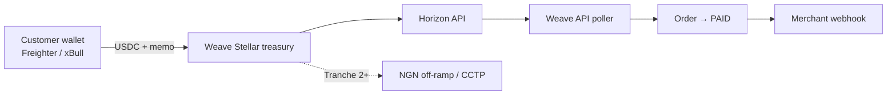

# Stellar Integration — Weave Priority 1

**Status:** Testnet-ready (Tranche 1)  
**Branch:** `joe-dev`

Weave checkout accepts **USDC payments on Stellar** via Stellar Wallets Kit; customer wallet → Weave Stellar treasury, confirmed in seconds via Horizon polling.

---

## Architecture



### Payment flow

1. Customer selects **Pay with Stellar wallet** in checkout.
2. Widget creates order with `flow: "stellar"` and source `crypto:STELLAR:USDC`.
3. Router plans a single **stellar** hop: USDC → Weave treasury (memo = order id, max 28 chars).
4. Customer connects wallet (Stellar Wallets Kit), signs USDC payment including memo.
5. Backend polls Horizon (`/jobs/poll-stellar-step` via QStash) or `GET /orders/:id` sync fallback.
6. On match (amount + memo), step → `done`, order → `completed`, merchant webhook fires.

### Preserved rails (unchanged)

| Rail | Flow | Provider |
|------|------|----------|
| NGN bank / Paystack | `external` / fiat | `paystack` |
| EVM connected wallet | `self` | `chainrails` (when wired) |
| Any-chain crypto deposit | `external` | `nearintents` |
| **Stellar USDC wallet** | **`stellar`** | **`stellar`** |

---

## Environment variables

### API (`apps/api/.env`)

| Variable | Description |
|----------|-------------|
| `STELLAR_NETWORK` | `testnet` (default) or `mainnet` |
| `STELLAR_HORIZON_URL` | Horizon endpoint (defaults per network) |
| `WEAVE_STELLAR_PUBLIC_KEY` | Treasury account public key (required) |
| `WEAVE_STELLAR_SECRET_KEY` | Treasury secret — **vault only**; used for trustline setup |
| `STELLAR_USDC_ISSUER` | Circle USDC issuer (defaults per network) |
| `STELLAR_POLL_INTERVAL_MS` | Poll interval (default `10000`) |
| `API_BASE` | Required for QStash poll scheduling |

### Widget (`apps/widget/.env`)

| Variable | Description |
|----------|-------------|
| `VITE_STELLAR_NETWORK` | Must match API network |
| `VITE_STELLAR_HORIZON_URL` | Optional Horizon override |
| `VITE_STELLAR_USDC_ISSUER` | Optional issuer override |

### USDC issuers (Circle)

- **Testnet:** `GBBD47IF6LWK7P7MDEVSCWR7DPUWV3NY3DTQEVFL4NAT4AQH3ZLLFLA5`
- **Mainnet:** `GA5ZSEJYB37JRC5EAAOKU5YDTYNNAMDR2EMH5QAFB5S64XAHQXHUM5N`

---

## Treasury setup (testnet)

1. Create a Stellar keypair (Freighter testnet or `stellar-sdk` Keypair.random()).
2. Fund with testnet XLM: https://laboratory.stellar.org/#account-creator?network=test
3. Set `WEAVE_STELLAR_PUBLIC_KEY` / `WEAVE_STELLAR_SECRET_KEY` in API `.env`.
4. Establish USDC trustline (once):

```typescript
import { ensureTreasuryTrustline } from './src/services/stellar.service';
await ensureTreasuryTrustline();
```

5. Fund test USDC from Circle testnet faucet or Stellar testnet USDC issuer.

---

## API endpoints

| Method | Path | Auth | Purpose |
|--------|------|------|---------|
| GET | `/api/v1/stellar/config` | Public | Network, treasury pubkey, USDC issuer |
| POST | `/api/v1/orders` | API key | Pass `flow: "stellar"` for Stellar checkout |
| POST | `/jobs/poll-stellar-step` | QStash | Internal payment detection |

---

## Demo merchant

**Afriloom Textiles** — ₦150,000 order → ~93.65 USDC on Stellar (FX via existing quote engine).

---

## Tranche roadmap

| Tranche | Scope |
|---------|--------|
| **1 (this doc)** | Stellar Wallets Kit + USDC checkout + treasury + Horizon detection |
| 2 | CCTP + Abroad/BlindPay NGN off-ramp + pilot merchants |
| 3 | Mainnet launch + SDP + 3–5 live merchants + Soroban escrow OSS |

---

## Application copy

**One-liner:**  
Weave is a unified checkout API that lets African merchants accept bank transfers and crypto wallets in one flow — customers pay however they want; merchants settle in Naira or stablecoins.

**Stellar integration:**  
Weave checkout accepts USDC payments on Stellar via Stellar Wallets Kit; customer wallet → Weave Stellar treasury, confirmed in seconds.

---

## Team gaps (non-code)

Items still needed for CV Labs application: legal entity, founder locations, team bios, product stage, GitHub URL, pitch deck, demo video, traction evidence (merchant pilot count — frame as validation pipeline, not GMV).
